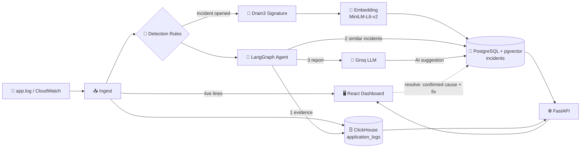

<div align="center">

# 🚨 AI Incident Detector

### An AI SRE Assistant with Rule-Based Detection, LLM Investigation Agents & Incident Memory

*Detect incidents from live logs, get an evidence-backed root-cause suggestion in seconds, and learn from every incident you resolve.*

<p>
  
  
  
  
  
  
</p>

<p>
  
  
  
</p>

[**🏗 Architecture**](#-architecture) · [**⚡ Quick Start**](#-quick-start) · [**🔌 API Reference**](#-api-reference) · [**🖥 Dashboard**](#-dashboard) · [**🗺 Roadmap**](#-roadmap)

<!-- Replace with a real screenshot or GIF: -->
<!--  -->

</div>

---

## 📌 Overview

**AI Incident Copilot** is an end-to-end incident response system that watches application logs, opens incidents with deterministic rules, and uses an LLM agent to investigate them. It goes beyond "send the logs to a chatbot" by combining:

- **Rule-based detection**: 20+ rules (error rate, latency, silence, resource, dependency, queue, security, certificates) with no LLM in the alerting path
- **Evidence-grounded agent**: a LangGraph workflow collects the right logs for each incident type, then writes a structured report
- **Incident memory**: every resolved incident is embedded and stored in pgvector, so similar future incidents get proven hints
- **Human in the loop**: the AI only *suggests*; an engineer confirms the root cause and fix

> **Why it matters:** On-call engineers lose time searching logs and trying to remember "have we seen this before?". Rules keep alerts predictable and cheap, the agent does the searching, and the memory gets better with every incident you close.

---

## ✨ Key Features

| | Feature | Description |
|---|---|---|
| 🎯 | **Rule-Based Detection** | 20+ configurable rules across statistical, traffic, log-pattern, metric, security and certificate checks |
| 🧩 | **Drain3 Signatures** | Raw logs are clustered into stable templates to build a signature for every incident |
| 🧬 | **Vector Incident Memory** | Signatures are embedded (MiniLM) and stored in pgvector to find similar *resolved* incidents |
| 🤖 | **LangGraph Agent** | Collect evidence → find similar incidents → generate report → save, triggered automatically when an incident opens |
| 📝 | **Structured AI Report** | Symptoms, suggested root cause, suggested solution, evidence and confidence (HIGH / MEDIUM / LOW) |
| 🛑 | **Honest by Design** | Says "unable to determine" when evidence is thin instead of guessing |
| 📡 | **Live Log Tail** | Lines from `app.log` show up in the UI within about a second, before they reach the database |
| 🖥 | **React Dashboard** | Incident list, incident detail with the AI report, live logs, service health and rules |
| ☁️ | **CloudWatch Ready** | Ingest from a local file or AWS CloudWatch Logs |
| 🔁 | **No Duplicate Incidents** | Fingerprinting + a unique index on open incidents + a 15-minute suppression window |

---

## 🏗 Architecture



### Incident lifecycle

1. **A log line arrives** and is parsed (JSON, `[service]` brackets and `key=value` formats are supported).
2. The line is **shown in the live tail**, then **stored in ClickHouse**.
3. A **detection rule matches** and an incident is opened (deduplicated by fingerprint).
4. A **signature** is built from Drain3 templates, **embedded**, and saved on the incident.
5. The **agent starts automatically**:
   1. Collect evidence for that rule: baseline vs incident windows, top error groups, WARN lines before the first error, request traces, metrics, recent changes.
   2. Retrieve similar resolved incidents:

      ```
      similarity = 1 - cosine_distance(embedding_new, embedding_past)   # keep >= 0.75
      ```

   3. Ask the LLM for a report using **only** that evidence.
   4. Save the five AI fields on the incident.
6. A **human resolves** the incident with the real root cause and fix. These are stored as *confirmed* and become hints for future incidents.

---

## 🛠 Tech Stack

| Layer | Technology |
|---|---|
| **Language** | Python 3.11+ |
| **API Framework** | `FastAPI` · `Uvicorn` · `Pydantic` |
| **Frontend** | `React 18` · `Vite` · `React Router` |
| **Agent Orchestration** | `LangGraph` |
| **LLM** | `Groq API` · `openai/gpt-oss-20b` |
| **Embeddings** | `sentence-transformers` · `all-MiniLM-L6-v2` (384 dims) |
| **Log Clustering** | `Drain3` |
| **Vector Store** | `pgvector` (cosine distance) |
| **Log Store** | `ClickHouse` via `clickhouse-connect` |
| **Control-Plane Database** | `PostgreSQL` via `psycopg2` |
| **Log Sources** | Local file tail · AWS CloudWatch (`boto3`) |
| **Configuration** | `python-dotenv` |

**Why two databases?** Logs are high-volume and append-only, so they go to ClickHouse for fast time-window queries. Incidents, services, metrics, certificates and embeddings are small and relational, so they stay in PostgreSQL.

---

## 🎯 Detection Rules

| Group | Rules |
|---|---|
| **Statistical** | `error_rate` (above `max(5%, 3x baseline)` for 2 min) · `new_error_type` (fingerprint not seen in 24h) · `latency_spike` (p95 above 2x baseline for 3 min) |
| **Traffic** | `traffic_silence` (no logs for 5 min) · `traffic_drop` (under 30% of the same time yesterday) |
| **Log Patterns** | `dependency_failure` · `resource_exhaustion` · `queue_backlog` · `auth_failure_spike` |
| **Metrics** | `cpu_high` · `memory_high` · `disk_high` · `restart_loop` · `queue_age_high` · `queue_depth_growing` · `dlq_not_empty` |
| **Security** | `security_ip_spike` (many failed-auth or 4xx/5xx lines from one IP) |
| **Scheduled** | `certificate_expiry` (30 / 14 / 7 days) |

Every rule has its own evidence collector, so the agent receives the data that matters for that incident type.

---

## 📊 Performance

<!-- Fill in with your real measurements. The agent prints per-step timings in the terminal, e.g. "[agent] #1230 LLM: 3.2s". -->

| Metric | Result |
|---|---|
| Log line → visible in the live tail | `~__ s` |
| Incident opened (signature + embedding) | `~__ s` |
| Agent: evidence collection | `~__ s` |
| Agent: LLM report | `~__ s` |
| End-to-end: error line → AI suggestion | `~__ s` |

---

## ⚡ Quick Start

### Prerequisites
- Python 3.11+ and Node.js 18+
- PostgreSQL 15+ with the **pgvector** extension
- ClickHouse
- A free [Groq API key](https://console.groq.com)
- Docker (optional, the easiest way to run the databases)

### 1. Clone and install
```bash
git clone https://github.com/pateltark/ai-incident.git
cd ai-incident

python -m venv venv
# Windows (PowerShell):  .\venv\Scripts\Activate.ps1
# macOS / Linux:         source venv/bin/activate

pip install -r requirements.txt
pip install clickhouse-connect boto3 drain3 fastapi "uvicorn[standard]"
```

### 2. Start the databases
```bash
docker run -d --name incident-pg -p 5432:5432 \
  -e POSTGRES_PASSWORD=postgres pgvector/pgvector:pg16

docker run -d --name incident-ch -p 8123:8123 -p 9000:9000 \
  -e CLICKHOUSE_USER=default -e CLICKHOUSE_PASSWORD=clickhouse \
  clickhouse/clickhouse-server
```

### 3. Configure
Create a `.env` file in the project root:

```env
# PostgreSQL (control plane)
DB_HOST=localhost
DB_PORT=5432
DB_NAME=incident_copilot
DB_USER=postgres
DB_PASSWORD=postgres
DB_POOL_MAX=10

# ClickHouse (logs)
CH_HOST=localhost
CH_PORT=8123
CH_USER=default
CH_PASSWORD=clickhouse
CH_DATABASE=incident_copilot

# LLM
GROQ_API_KEY=your_groq_api_key
AGENT_REASONING_EFFORT=low        # low | medium | high

# Log source
LOG_SOURCE=local                  # local | cloudwatch
LOCAL_LOG_FILE=app.log
SERVICE_NAME=my-service           # fallback when a line has no service name

# Dashboard ingest
INGEST_ENABLED=1                  # 0 = turn the background file ingest off
INGEST_POLL=1                     # seconds between file checks

# Only for LOG_SOURCE=cloudwatch
# AWS_REGION=ap-south-1
# CLOUDWATCH_LOG_GROUP=/your/log/group
# LOOKBACK_MINUTES=5
```

### 4. Create the tables

**PostgreSQL** (tables, indexes, pgvector column, default services):
```bash
python seed_data.py
```

**ClickHouse** (open a client with `docker exec -it incident-ch clickhouse-client --password clickhouse`):
```sql
CREATE DATABASE IF NOT EXISTS incident_copilot;

CREATE TABLE IF NOT EXISTS incident_copilot.application_logs
(
    id           UInt64,
    service_id   UInt32,
    service_name LowCardinality(String),
    level        LowCardinality(String),
    message      String,
    latency_ms   Nullable(Float64),
    request_id   String DEFAULT '',
    timestamp    DateTime64(3, 'UTC')
)
ENGINE = MergeTree
ORDER BY (service_name, timestamp);
```

> The remaining Postgres tables (`metrics`, `change_events`, `certificates`) and the `ai_*` columns are created automatically on startup.

### 5. Run (dashboard mode)

Open three terminals from the project root:

```bash
# Terminal 1: API + log ingest + detector + agent
uvicorn api:app --port 8000

# Terminal 2: dashboard  ->  http://localhost:5173
cd frontend && npm install && npm run dev

# Terminal 3: simulate application logs
python generate_logs.py
```

> The API does the log ingestion itself. **Do not also run** `connector_layer.py` or the `watch.py` tailer, or every line is stored twice. Avoid `--reload` while ingesting, because a restart skips lines written during it.

### 6. Try it

In the log generator (terminal 3):

```text
> error checkout out of memory killed process
> burst 10 payment database connection timeout
> latency 10 payment 9000
> random 50 inventory
```

Within a few seconds the lines appear on **Live logs**, an incident appears on **Incidents**, and its **AI investigation** card fills in by itself. Open it, review the suggestion, and resolve it with the real root cause and fix.

### Command-line mode (no dashboard)

```bash
python connector_layer.py     # terminal 1: tail app.log into ClickHouse
python watch.py               # terminal 2: detector + interactive console
python generate_logs.py       # terminal 3: write logs
```

<details>
<summary><b>Console commands</b></summary>

| Command | Description |
|---|---|
| `check [service]` | Run all detection rules now |
| `rules` | List every rule and threshold |
| `incidents` | List incidents |
| `signature <id>` | Show an incident's signature |
| `templates <service>` | Show learned Drain3 templates |
| `resolve <id>` | Close an incident with a root cause and resolution |
| `autoclose [minutes]` | Report open incidents whose condition has cleared |
| `logs <service> [n]` | Show recent logs from ClickHouse |
| `services` | List services |
| `fp <message>` | Show how a message is normalised and fingerprinted |

</details>

---

## 🧰 Use It With Your Own Logs

1. **Point it at your log file.** Set `LOCAL_LOG_FILE`. Each line needs a level and a service name in one of these shapes:
   ```text
   2026-10-30T12:04:10Z ERROR [checkout] payment gateway timeout
   {"level":"ERROR","service":"checkout","message":"...","latency_ms":820,"request_id":"abc"}
   level=ERROR service=checkout latency_ms=820 msg="..."
   ```
2. **Register your services** in `KNOWN_SERVICES` in `watch.py`. Unknown services are created automatically when their first log arrives.
3. **Tune the rules.** Thresholds are at the top of `watch.py`; regex patterns and metric rules are in `db.py` (`LOG_PATTERN_RULES`, `METRIC_RULES`).
4. **Use CloudWatch.** Set `LOG_SOURCE=cloudwatch`, `AWS_REGION` and `CLOUDWATCH_LOG_GROUP`, then run `python connector_layer.py`. AWS credentials come from your standard AWS configuration.
5. **Teach it.** Resolve incidents with a clear root cause and resolution. The more you close, the better the similar-incident hints become.

---

## 🔌 API Reference

Interactive docs: `http://localhost:8000/docs`

| Method | Endpoint | Description |
|---|---|---|
| `GET` | `/api/incidents` | List incidents (`status`, `severity`, `service`, `limit`) |
| `GET` | `/api/incidents/{id}` | Detail: AI suggestion, error timeline, log evidence, similar incidents |
| `POST` | `/api/incidents/{id}/resolve` | Resolve with `{ "root_cause": "...", "resolution": "..." }` |
| `POST` | `/api/incidents/{id}/investigate` | Re-run the agent for an incident |
| `GET` | `/api/live` | Live tail of lines read from `app.log` (cursor based) |
| `GET` | `/api/logs` | Query stored logs from ClickHouse |
| `GET` | `/api/services` | Per-service volume, error rate, p95 latency, open incidents |
| `GET` | `/api/rules` | Detection rules and thresholds |
| `GET` | `/api/ingest/status` | State of the background ingest |
| `GET` | `/api/health` | Service health check |

<details>
<summary><b>Example response: <code>GET /api/incidents/1230</code> (abridged)</b></summary>

```json
{
  "id": 1230,
  "service": "checkout",
  "rule": "resource_exhaustion",
  "severity": "high",
  "status": "open",
  "started_at": "2026-10-30T12:04:49+00:00",
  "ai": {
    "symptoms": "An \"out of memory killed process\" error was logged in checkout...",
    "root_cause": "Unable to determine from available evidence.",
    "solution": "No specific fix can be confidently recommended based on the current evidence.",
    "evidence_points": [
      "Single ERROR log: out of memory killed process",
      "No matching pattern in the baseline hour; the error is new to this service."
    ],
    "confidence": "LOW"
  },
  "similar": [],
  "timeline": [{ "minute": "2026-10-30T12:04:00+00:00", "total": 1, "errors": 1 }],
  "log_lines": [
    { "ts": "2026-10-30T12:04:10.114000+00:00", "level": "ERROR", "message": "..." }
  ]
}
```
</details>

---

## 🖥 Dashboard

| Page | What you get |
|---|---|
| **Incidents** | Filterable table with severity, status, AI confidence and age |
| **Incident detail** | AI investigation card, errors-per-minute chart, similar past incidents, log evidence, and a resolve form pre-filled with the AI suggestion |
| **Live logs** | Real-time tail with service and level filters and a pause button |
| **Services** | One card per service: log count, error rate, p95 latency, open incidents |
| **Rules** | Read-only view of every rule and threshold |

<!-- Add screenshots here, for example:  -->

### Example agent output

```text
Incident Report

Symptoms:
An "out of memory killed process" error was logged in the checkout service at
2026-10-30 12:04:10. It was the only matching error and did not appear in the
preceding baseline hour.

Root cause:
Unable to determine from available evidence.

Solution:
No specific fix can be confidently recommended based on the current evidence.

Evidence:
- Single ERROR log: "... ERROR [checkout] out of memory killed process"
- No matching pattern in the baseline hour; the error is new to this service.
- No WARN logs or cross-service traces preceding the error.

Confidence:
LOW
```

---

## 🧠 Design Decisions

- **Rules detect, the LLM explains.** Detection is deterministic and testable. The model never decides whether something is an incident.
- **Evidence is the source of truth.** The prompt forbids inventing logs, causes or fixes. Thin evidence means "unable to determine" and low confidence.
- **Past incidents are hints, not facts.** Only *resolved and human-confirmed* incidents from the *same service* are retrieved. The current evidence must support a past cause before it is used, and confidence is capped when the only support is a past incident.
- **Humans close incidents.** AI output lives in separate `ai_*` columns. `root_cause` and `resolution` are written only when a person resolves the incident.
- **One incident per problem.** Messages are normalised (numbers, IDs, IPs, UUIDs removed) and hashed into a fingerprint. A partial unique index allows one open incident per service and fingerprint.
- **Right store for each job.** ClickHouse for logs, PostgreSQL for relational data, pgvector for similarity.
- **UTC everywhere.** All timestamps are treated and shown as UTC.

---

## ☁️ Deployment

The project runs locally today. For a production setup:

```
Logs (file / CloudWatch) ──▶ API + Ingest (one process) ──▶ ClickHouse + PostgreSQL (managed)
                                      │
                                      └──▶ Dashboard (static build behind a reverse proxy)
```

1. Run PostgreSQL (with pgvector) and ClickHouse as managed services or containers.
2. Run `uvicorn api:app` as a single process, because the ingest and detector run inside it.
3. Build the dashboard with `npm run build` and serve it behind a reverse proxy that forwards `/api` to the API.
4. Inject database credentials and `GROQ_API_KEY` through environment variables or a secrets manager.

A Docker Compose setup is on the [roadmap](#-roadmap).

---

## 🗂 Project Structure

```
.
├── api.py                 # FastAPI backend: REST endpoints + live log tail
├── ingest.py              # app.log -> live buffer -> ClickHouse -> incident detection
├── watch.py               # Detector engine, rules and interactive CLI
├── main.py                # LangGraph investigation agent
├── db.py                  # Database access and per-rule evidence collectors
├── connector_layer.py     # Log parsing and ClickHouse writer (file + CloudWatch)
├── drain_templates.py     # Drain3 log template clustering
├── embedder.py            # Text -> vector (sentence-transformers)
├── resolve.py             # Resolve an incident from the terminal
├── generate_logs.py       # Interactive log generator for demos
├── seed_data.py           # Creates PostgreSQL tables, indexes and default services
├── drain3.ini             # Drain3 configuration
├── requirements.txt
└── frontend/              # React dashboard (Vite)
    └── src/
        ├── pages/         # Incidents, IncidentDetail, LiveLogs, Services, Rules
        ├── components.jsx
        ├── api.js
        └── styles.css
```

---

## 🩺 Troubleshooting

| Symptom | Fix |
|---|---|
| Logs appear twice | `connector_layer.py` or the `watch.py` tailer is running alongside the API ingest. Run only one. |
| No new incident for a repeated log | The same message is suppressed for 15 minutes. Use a different message. |
| An incident has no AI suggestion | Check `GROQ_API_KEY` and the API terminal for `[agent]` lines, then use **Re-run investigation**. |
| First incident is slow | The embedding model is loading (about 90 MB, one time). It is cached afterwards. |
| Dashboard shows "Could not load..." | The API is not running or crashed. Check its terminal. |
| `pgvector` error in `seed_data.py` | The extension is missing. Use the `pgvector/pgvector` Docker image or install it. |

---

## 🗺 Roadmap

- [x] Log ingestion (file and CloudWatch) into ClickHouse
- [x] Rule-based detection with deduplication
- [x] Drain3 signatures and pgvector similar-incident search
- [x] LangGraph investigation agent with structured reports
- [x] Human resolution flow that builds incident memory
- [x] FastAPI backend and React dashboard
- [ ] Docker Compose for one-command startup
- [ ] Resolution watcher: detect when an error stops and link the fix (for example, nearby git commits)
- [ ] Evaluation suite for report quality
- [ ] Authentication for the dashboard and API
- [ ] CloudWatch support in the dashboard ingest
- [ ] Automated tests and CI

---

## 🤝 Contributing

Contributions are welcome. Fork the repo, create a feature branch, and open a pull request.

## 📄 License

Distributed under the MIT License. See `LICENSE` for details.

---

<div align="center">

### 👨‍💻 Built by **Tark Patel**

[](https://linkedin.com/in/<your-handle>)
[](https://github.com/pateltark)

⭐ *If you found this useful, consider giving it a star!*

</div>
